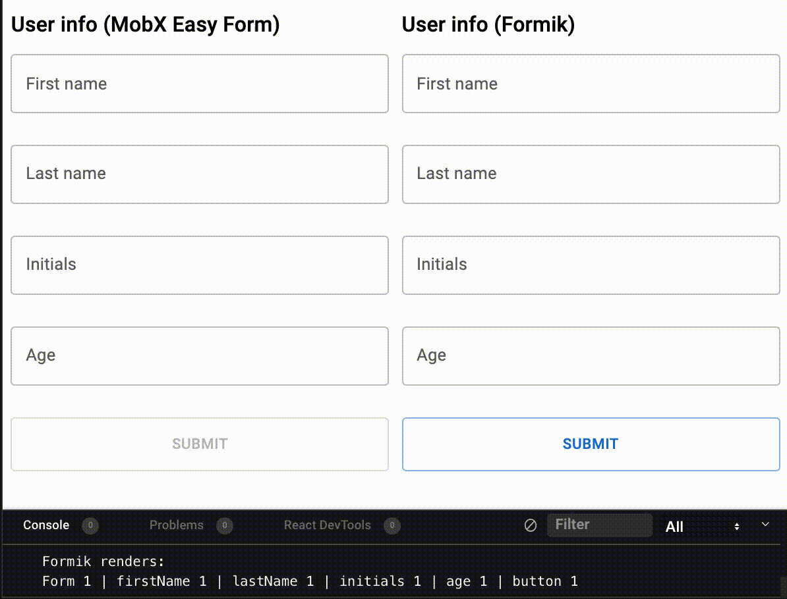

# MobX Easy Form


Simple and performant form library built with MobX.

Works with React, React Native and any other framework that supports MobX.

## Motivation

This library is heavily inspired by [Formik](https://github.com/formium/formik). I like Formik, but there are some issues with Formik that MobX Easy Form solves.

### 1. Performace

Forms can get very complicated. Formik can get slow as the form grows as it re-renders the whole form on every keystroke. There are available optimizations but it's complex to setup and can introduce bugs like a field not rendering when it should.

MobX Easy Form solves this issue with MobX. It makes sure to re-render only the components that need to re-render.

You can see the difference in the following GIF. The number of times each component renders is shown below.

<p align="center">

</p>

### 2. Validation limitations

Formik forces you to define the `validationScheme` and `initialValues` for all your fields at the same time, which means you can't change the validation logic based on the value of some field.

With MobX Easy Form you define each field separately so you can use one field value to initialize another.

## Installation

### Installing the dependencies

MobX Easy Form depends on `mobx`, and if you're using React, you'll also need `mobx-react-lite` (or `mobx-react` if you support class components). To install these, run

```bash
npm install mobx mobx-react-lite

# if you use yarn
yarn add mobx mobx-react-lite
```

### Installing MobX Easy Form

```bash
npm install mobx-easy-form

# if you use yarn
yarn add mobx-easy-form
```

## Quick start with React

```tsx
import { useForm, useField } from "mobx-easy-form";
import { Observer, observer } from "mobx-react";
import { z } from "zod";

export default observer(function Form() {
  // 1. Define each field on its own.
  const firstName = useField({
    initialValue: "",
  });

  const lastName = useField({
    initialValue: "",
  });

  const initials = useField({
    initialValue: "",
    validate(initials) {
      if (
        initials.length === 2 &&
        initials[0] === firstName.state.value?.[0] &&
        initials[1] === lastName.state.value?.[0]
      ) {
        return { error: undefined, parsed: initials };
      }

      return { error: "Wrong initials", parsed: undefined };
    },
  });

  // Parsed type (number) is inferred from the schema. No generics needed.
  const age = useField({
    initialValue: "",
    validationSchema: z.coerce.number(),
  });

  // 2. Collect the fields into a form. The keys you choose here become the
  //    keys of `values`, fully typed: values.age is `number`, the rest `string`.
  const form = useForm({
    fields: { firstName, lastName, initials, age },
    onSubmit({ values }) {
      console.log("Values:", values);
    },
  });

  return (
    <div>
      <h1>User info</h1>

      <Observer>
        {() => {
          return (
            <div>
              <div>First name</div>
              <input
                value={firstName.state.value}
                onChange={(e) => firstName.actions.onChange(e.target.value)}
                onFocus={() => firstName.actions.onFocus()}
                onBlur={() => firstName.actions.onBlur()}
              ></input>
              <div>{firstName.computed.ifWasEverBlurredThenError}</div>
            </div>
          );
        }}
      </Observer>

      <Observer>
        {() => {
          return (
            <div>
              <div>Last name</div>
              <input
                value={lastName.state.value}
                onChange={(e) => lastName.actions.onChange(e.target.value)}
                onFocus={() => lastName.actions.onFocus()}
                onBlur={() => lastName.actions.onBlur()}
              ></input>
              <div>{lastName.computed.ifWasEverBlurredThenError}</div>
            </div>
          );
        }}
      </Observer>

      <Observer>
        {() => {
          return (
            <div>
              <div>Initials</div>
              <input
                value={initials.state.value}
                onChange={(e) => initials.actions.onChange(e.target.value)}
                onFocus={() => initials.actions.onFocus()}
                onBlur={() => initials.actions.onBlur()}
              ></input>
              <div>{initials.computed.ifWasEverBlurredThenError}</div>
            </div>
          );
        }}
      </Observer>

      <Observer>
        {() => {
          return (
            <div>
              <div>Age</div>
              <input
                value={age.state.value}
                onChange={(e) => age.actions.onChange(e.target.value)}
                onFocus={() => age.actions.onFocus()}
                onBlur={() => age.actions.onBlur()}
              ></input>
              <div>{age.computed.ifWasEverBlurredThenError}</div>
            </div>
          );
        }}
      </Observer>

      <Observer>
        {() => {
          return (
            <button
              onClick={form.actions.submit}
              disabled={form.computed.isError && form.state.submitCount > 0}
            >
              SUBMIT ({form.computed.isError ? "invalid" : "valid"})
            </button>
          );
        }}
      </Observer>
    </div>
  );
});
```

## Migrating to V4

V4 changes how fields and forms are connected so that `onSubmit`'s `values` (and `rawValues`, and `fields`) are **fully typed automatically** — no generics, no manual type declarations.

### What changed

In V3 you created the form first, then each field registered itself into the form by receiving `form` and an `id`. The form had no idea what fields it would end up with, so `values` was `Record<string, unknown>`.

In V4 you do the opposite: create the fields first, then pass them to the form as a `fields` record. The keys of that record become the keys of `values`, and their types are inferred from each field.

| V3 | V4 |
| --- | --- |
| `createForm({ onSubmit })` first, fields self-register | Fields first, then `createForm({ fields, onSubmit })` |
| `createField({ id, form, initialValue })` | `createField({ initialValue })` — no `id`, no `form` |
| Field key comes from `id` | Field key comes from the `fields` record key |
| `form.actions.add(field)` | **removed** — pass fields to `createForm` instead |
| `field.state.id` | **removed** |
| `values` is `Record<string, unknown>` | `values` is fully typed from the field record |

### Before (V3)

```ts
const form = useForm({
  onSubmit({ values }) {
    // values.age is `unknown`
    console.log(values);
  },
});

const name = useField({ id: "name", form, initialValue: "" });
const age = useField({
  id: "age",
  form,
  initialValue: "",
  validationSchema: z.coerce.number(),
});
```

### After (V4)

```ts
const name = useField({ initialValue: "" });
const age = useField({
  initialValue: "",
  validationSchema: z.coerce.number(),
});

const form = useForm({
  fields: { name, age },
  onSubmit({ values }) {
    values.name; // string
    values.age; // number
  },
});
```

### Step-by-step

1. **Move field creation above the form.** Fields no longer need the `form`, so create them first.
2. **Remove `form` and `id` from every `createField` / `useField` call.** The record key replaces `id`.
3. **Add a `fields` record to `createForm` / `useForm`.** Use the names you previously passed as `id` as the record keys: `fields: { name, age }`.
4. **Replace `form.actions.add(field)` calls** — there is no `add` anymore; everything is passed up front via `fields`.
5. **Replace any `field.state.id` usage.** The id no longer exists on the field; use the key under which you stored it in the form.

> Note: the field set is now **closed** — it's whatever you pass to `createForm`. There is no runtime `add`/`remove`. This is what makes `values` fully typed. Dynamic forms (e.g. a variable number of rows) are intended to be served by a future `createFieldArray` primitive that nests as a single entry in the record.

### Typed `values`

`values.<key>` is typed as the field's **parsed/output** type, and `rawValues.<key>` as its **input** type:

```ts
const age = useField({ initialValue: "", validationSchema: z.coerce.number() });

const form = useForm({
  fields: { age },
  onSubmit({ values, rawValues }) {
    values.age; // number  (parsed output)
    rawValues.age; // string  (raw input held in state.value)
  },
});
```

`onSubmit` only runs when the form is valid, so `values.<key>` drops the "failed validation" `undefined` and gives you the clean parsed type. If a field's output type is *genuinely* optional (e.g. its schema/validate can return `undefined` as a valid result), that `undefined` is preserved.

## React Example on CodeSandbox

### [https://codesandbox.io/s/mobx-easy-form-example-xn3ss](https://codesandbox.io/s/mobx-easy-form-example-xn3ss)

## React Native Example on Expo Snack

### [https://snack.expo.dev/@hrastnik/react-native---mobx-easy-form](https://snack.expo.dev/@hrastnik/react-native---mobx-easy-form)

## Getting started

First create your fields. Each field is a standalone object — you only need an `initialValue`.

```ts
const firstName = useField({
  initialValue: "",
});
```

Then create the form, passing all your fields as a record. The **keys you pick** here are how you'll access the fields later, and they're also what drives the type inference for `onSubmit`.

```ts
const form = useForm({
  fields: { firstName },
  async onSubmit({ values }) {
    // `values` is fully typed from the field record.
    console.log(values.firstName); // string
  },
});
```

The key is also how you access the field through the `form` object — it's the exact same instance you passed in.

```ts
form.fields.firstName === firstName; // true
```

Because each field is created on its own before the form, you can use one field's value inside another field's validation (e.g. a "confirm password" field).

```ts
const password = useField({ initialValue: "" });
const confirmPassword = useField({
  initialValue: "",
  validate: (value) =>
    value === password.state.value
      ? { error: undefined, parsed: value }
      : { error: "Passwords must match", parsed: undefined },
});

const form = useForm({ fields: { password, confirmPassword }, onSubmit });
```

You can pass a validation function to `useField`, or use any validator that implements the [Standard Schema](https://standardschema.dev) spec — including [Zod](https://zod.dev), [Valibot](https://valibot.dev), and [ArkType](https://arktype.io). [Yup](https://github.com/jquense/yup) is also supported via its `validateSync` interface.

### Using Zod (or any Standard Schema validator)

```ts
import { z } from "zod";

const age = useField({
  initialValue: "",
  validationSchema: z.coerce.number().min(0, "Age must be positive"),
});
```

The library infers the input type from `initialValue` and the parsed/output type from `validationSchema`, so you usually don't need explicit generics. In this example `age.state.value` is `string` and `age.computed.parsed` is `number`.

### Using Yup

```ts
import { number } from "yup";

const age = useField({
  initialValue: "",
  validationSchema: number()
    .typeError("Age should be a number")
    .required("Age is required"),
});
```

MobX Easy Form uses the validation function for two things:

1. To check if the value is in the right format.
2. To parse the value and convert it to something usable.

In the example above, the field state will hold the string value of a number - e.g. `"42"`, but the schema will convert it to a number `42` that we can access through `age.computed.parsed` and is also the value we get in `onSubmit({ values })`.

### Synchronous validation only

Validation runs inside MobX computed values, so it must be synchronous. If a Standard Schema validator returns a `Promise` (for example, a Zod schema with `.refine(async ...)`), accessing `field.computed.parsed` or `field.computed.error` will throw. For async checks (e.g. server-side uniqueness), run them at the application level and call `field.actions.setError(...)` with the result.

### IMPORTANT!

> The `useForm` and `useField` are React hooks that use `createForm` and `createField` and cache the result so that React doesn't re-create the form on each render. In other words `useForm` and `useField` make sure the form and fields only get created once. If you want to re-create the fields you can pass a dependency array as the second parameter to `useForm` and `useFields`.

## Render

We can now render the inputs. A great performance optimization is to use the `<Observer>` component from `mobx-react` to limit the renders to only the input that needs to change. Alternatively you can create your own input component with the `observer` HOC.

Each field has the `state`,`computed` and `actions` props.

```tsx
<Observer>
  {() => {
    return (
      <div>
        <div>First name</div>
        <input
          value={firstName.state.value}
          onChange={(e) => firstName.actions.onChange(e.target.value)}
          onFocus={() => firstName.actions.onFocus()}
          onBlur={() => firstName.actions.onBlur()}
        ></input>
        <div>{firstName.computed.ifWasEverBlurredThenError}</div>
      </div>
    );
  }}
</Observer>
```

## API

### `useForm` / `createForm`

| parameter  | type                         | required | description                                                                                                                              |
| ---------- | ---------------------------- | -------- | ---------------------------------------------------------------------------------------------------------------------------------------- |
| `fields`   | Record<string, Field>;       | true     | The complete record of fields for this form. The keys become the keys of `values`/`rawValues`/`fields`, and drive the type inference.    |
| `onSubmit` | (props: OnSubmitArg) => any; | true     | Function that will be ran when `form.actions.submit` is called if the form is valid.                                                     |

Returns a `Form` instance.

### `OnSubmitArg`

| parameter   | type                  | description                                                                                                                                                                 |
| ----------- | --------------------- | --------------------------------------------------------------------------------------------------------------------------------------------------------------------------- |
| `fields`    | typeof `fields`       | The exact field record passed to `createForm`/`useForm` — same instances, keyed by the same keys.                                                                          |
| `rawValues` | typed by field input  | The raw input value (`field.state.value`) of every field, keyed by field key. Typed automatically from each field's input type.                                            |
| `values`    | typed by field output | The parsed/output value of every field, keyed by field key. Typed automatically from each field's parsed type (the value returned by `validate` / the validation schema).  |

### `useField` / `createField`

| parameter          | type                                                                                        | required | description                                                                                                                                                                                                                                                       |
| ------------------ | ------------------------------------------------------------------------------------------- | -------- | ----------------------------------------------------------------------------------------------------------------------------------------------------------------------------------------------------------------------------------------------------------------- |
| `initialValue`     | any                                                                                         | required | The initial value of the field. If you're using TypeScript, note that this field will be used to type the values you can set through `onChange`, so for optional fields consider using a cast to add the `undefined` type. (`initalValue: "" as "" \| undefined`) |
| `validationSchema` | StandardSchemaV1 \| Yup.ValidationSchema                                                    | optional | A schema used to validate and parse the field value. Accepts any [Standard Schema](https://standardschema.dev) validator (Zod, Valibot, ArkType, etc.) or a [Yup](https://github.com/jquense/yup) schema. You can only set one of `validationSchema` and `validate`. |
| `validate`         | (value: any) => { error?: undefined, parsed: any } \| { error: string, parsed?: undefined } | optional | Validation function used to validate and parse the value. It receives the value and must return and object with either `error` or `parsed` set                                                                                                                    |
| `initialError`     | string                                                                                      | optional | Initial error for the field                                                                                                                                                                                                                                       |

Returns a `Field` instance

### `Field`

| parameter                            | type                          | description                                                                                            |
| ------------------------------------ | ----------------------------- | ------------------------------------------------------------------------------------------------------ |
| `state.errorOverride`                | string \| undefined           | Custom error message set on the field                                                                  |
| `state.isFocused`                    | boolean                       | `true` if the field is focused, `false` otherwise                                                      |
| `state.value`                        | any                           | Current value of the field                                                                             |
| `state.wasEverBlurred`               | string                        | `true` if the field was ever blurred, `false` otherwise                                                |
| `state.wasEverFocused`               | string                        | `true` if the field was ever focused, `false` otherwise                                                |
| `computed.error`                     | string \| undefined           | Custom error message set on the field                                                                  |
| `computed.ifWasEverBlurredThenError` | string \| undefined           | if the field was ever blurred returns the value of `computed.error`, otherwise returns `undefined`     |
| `computed.ifWasEverFocusedThenError` | string \| undefined           | if the field was ever focused returns the value of `computed.error`, otherwise returns `undefined`     |
| `computed.isDirty`                   | boolean                       | `true` if value is different from `initialValue`, `false` otherwise                                    |
| `computed.parsed`                    | any                           | Parsed value of the field. The parsed value returned by `validate` or cast using the validation schema |
| `actions.onBlur`                     | () => void                    | Sets `state.isFocused` to false. Should be passed to text inputs `onBlur`                              |
| `actions.onChange`                   | (value: any) => void          | Sets `state.value` to the provided value. Additionally, it clears the errorOverride if it was set      |
| `actions.onFocus`                    | () => void                    | Sets `state.isFocused` to true. Should be passed to text inputs `onFocus`                              |
| `actions.setError`                   | (string \| undefined) => void | Sets `state.errorOverride` to the provided value                                                       |

### `Form`

| parameter                           | type                    | description                                                                                                                                                                                                     |
| ----------------------------------- | ----------------------- | --------------------------------------------------------------------------------------------------------------------------------------------------------------------------------------------------------------- |
| `state.isSubmitting`                | boolean                 | `true` if the form is submitting, when the `onSubmit` function is async                                                                                                                                         |
| `state.submitCount`                 | number                  | Number of times the form was submitted                                                                                                                                                                          |
| `state.valuesAtLastSubmit`          | string \| undefined     | Used internally. You shouldn't use this                                                                                                                                                                         |
| `computed.errorList`                | [string \| undefined]   | An array of errors for all the fields                                                                                                                                                                           |
| `computed.isChangedSinceLastSubmit` | boolean                 | `true` if any field has changed since last submit, `false` otherwise                                                                                                                                            |
| `computed.isDirty`                  | boolean                 | `true` if any field is dirty (value different from initialValue)                                                                                                                                                |
| `computed.isError`                  | boolean                 | `true` if any field has `error` different from `undefined`                                                                                                                                                      |
| `computed.isValid`                  | boolean                 | `true` if `isError` is `false`, `false` otherwise                                                                                                                                                               |
| `computed.valueList`                | any[]                   | An array of all the values. Used internally, you shouldn't use this.                                                                                                                                            |
| `actions.submit`                    | (value: any) => Promise | Sets `isSubmitting` to true, increases `submitCount`, for each field, sets the `wasEverFocused` and `wasEverBlurred` to `true`. Then, if `isError` is true does nothing, otherwise runs the `onSubmit` function |
